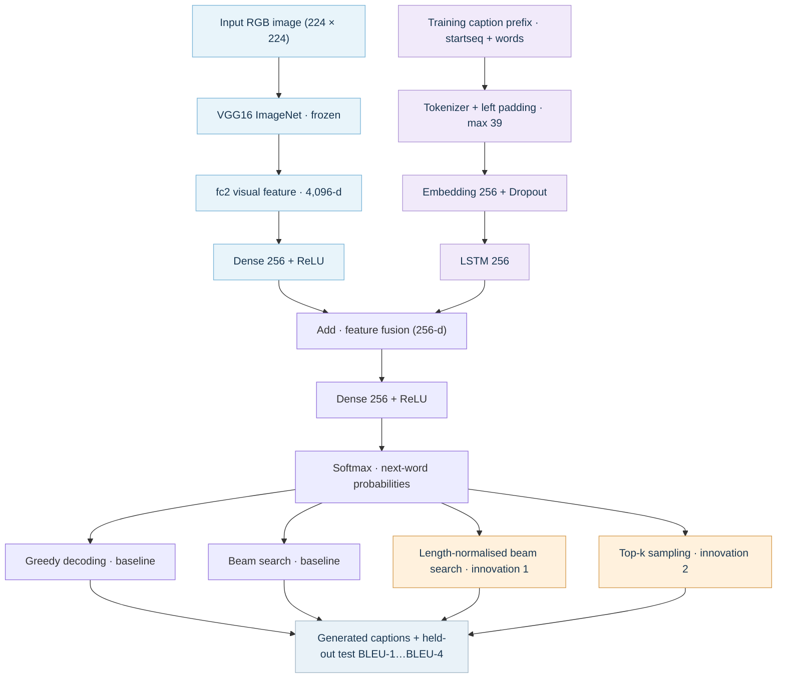

# Updated CNN–LSTM Architecture (Tutor-approved)

This diagram documents the *current project design* and the two tutor-approved decoding innovations. It complements the existing `mermaid-diagram.png` (retained to preserve team contributions).

**Important distinctions:** VGG16 features are extracted once and reused; no VGG16 retraining is required. The decoder is trained using only the image-level training split, with validation for model selection. Greedy/beam search and the two innovations operate **after** softmax during inference, not as trainable LSTM layers. Compare BLEU scores *before vs after* enhancements on the same held-out test set. Top-k sampling is stochastic, so record the random seed; results need not improve BLEU.

The full graphical PNG/SVG version can be inserted into the group report. Do not confuse example captions/illustrations with actual experimental outputs.
